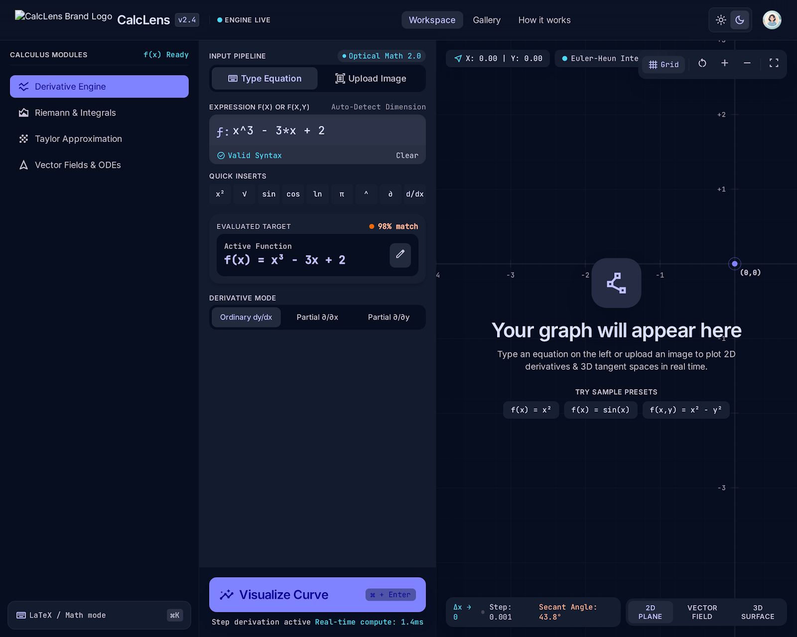
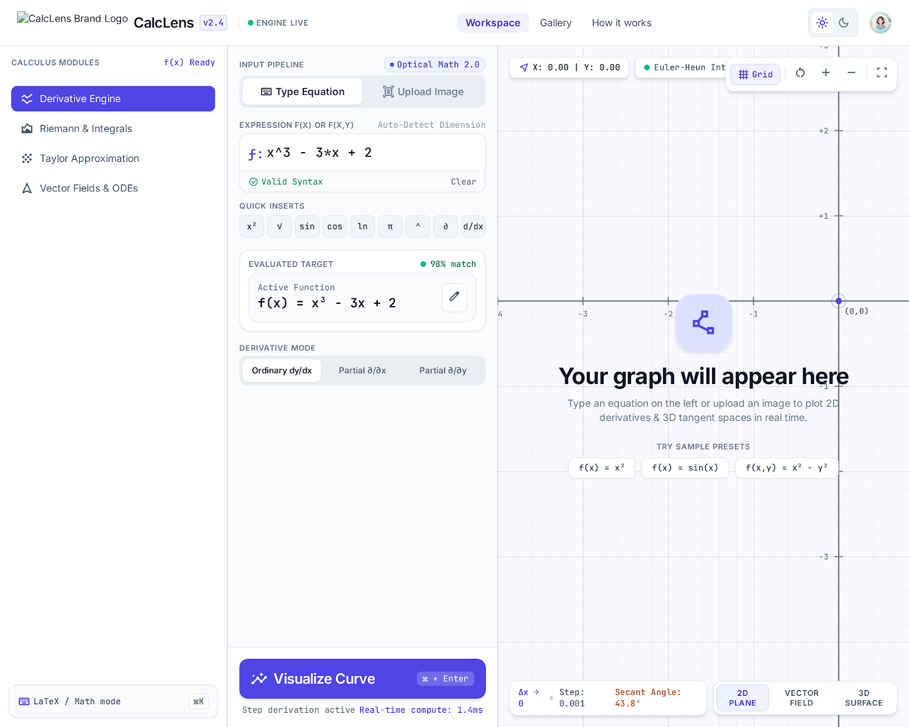
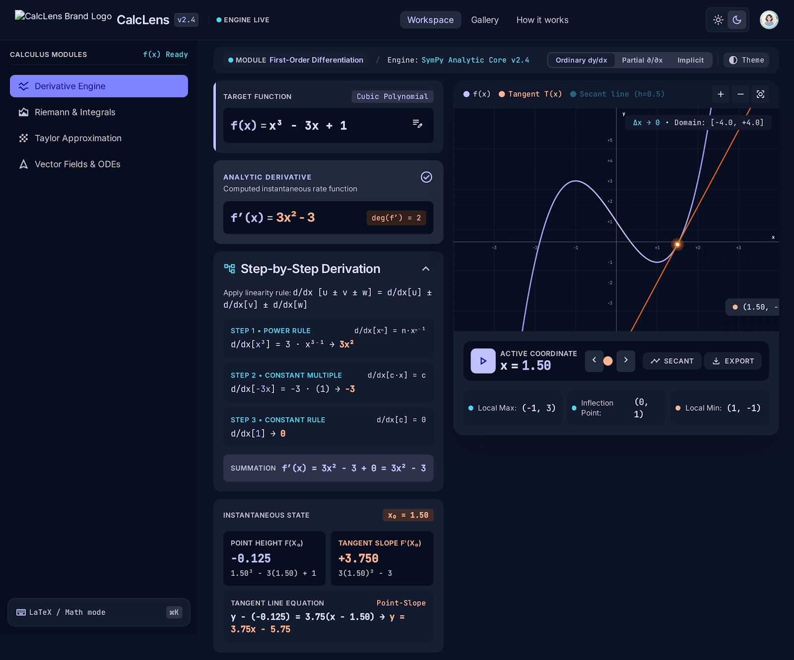
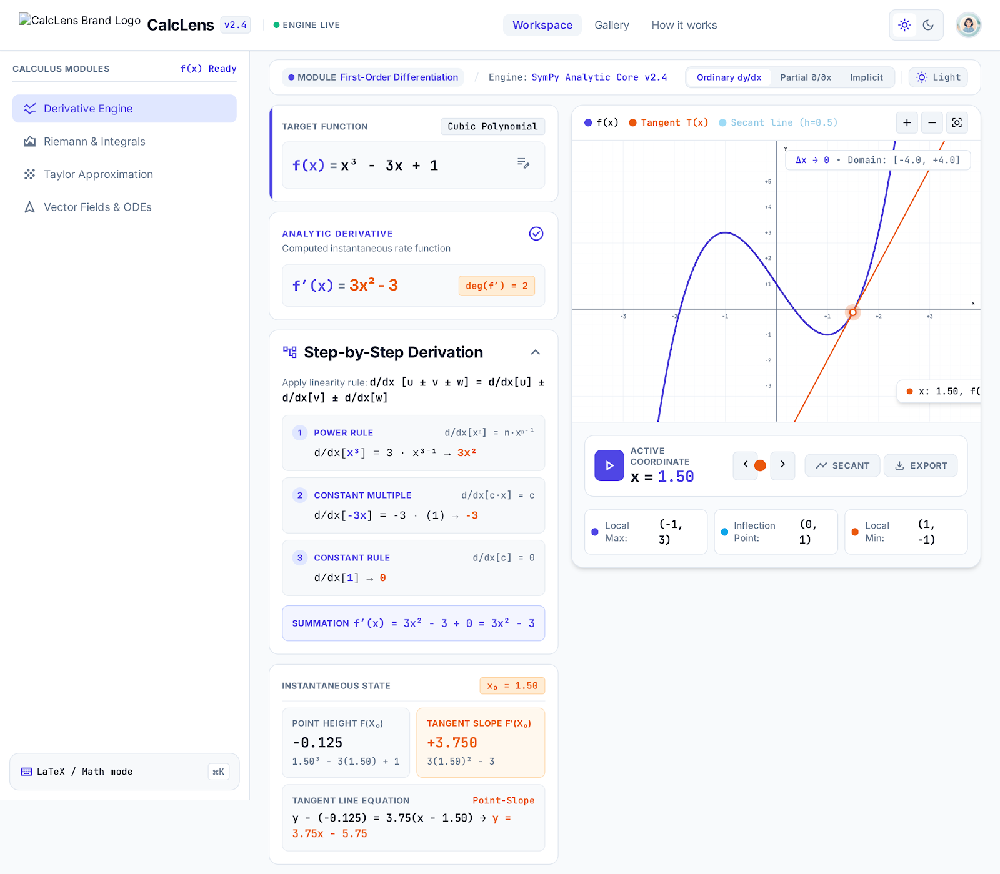
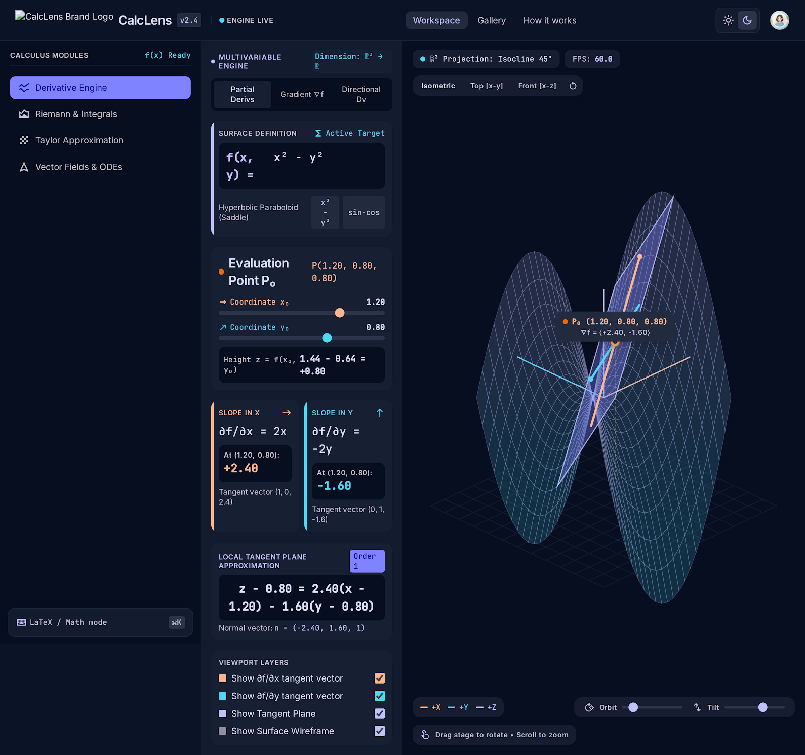
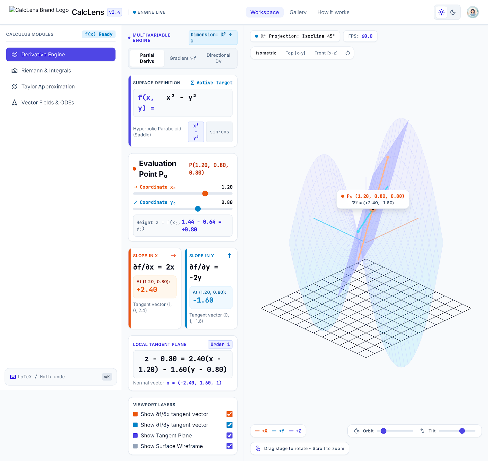
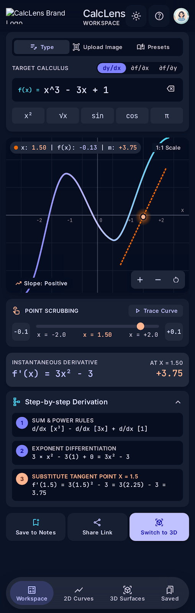
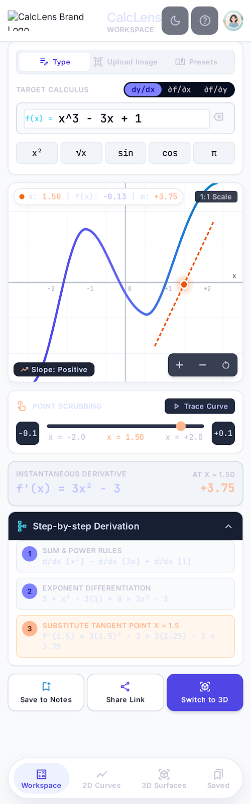
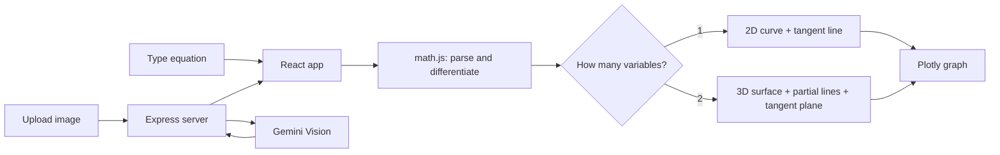

# 📐 CalcLens

**See the slope. Type a function or snap a photo of it, and CalcLens draws the graph (2D or 3D) with the tangent line, for both ordinary and partial derivatives.**



> Designed with Google Stitch · Built with Antigravity · Powered by Gemini, React and Plotly

---

## 📖 What is CalcLens?

Derivatives are easier to understand when you can *see* them. CalcLens is a calculus visualizer where you:

1. **Type** a function (like `x^2*y + sin(y)`) **or upload an image** of it, handwritten or printed.
2. Get an instant **graph**: a 2D curve for one variable, a 3D surface for two variables.
3. See the **slope line** at any point you choose:
   - **Ordinary derivative** → tangent line
   - **Partial derivatives** → ∂f/∂x line, ∂f/∂y line, and the tangent plane
4. Drag a slider to move the point and watch the slope change live, along with the derivative formula and its value.

It is built for students learning differential and multivariable calculus, and for teachers who want a quick classroom demo.

---

## 🖼️ Screenshots

### Workspace & Interactive Canvas
| Dark Mode | Light Mode |
|---|---|
|  |  |

### 2D Mode: Ordinary Derivatives & Tangents
| Dark Mode | Light Mode |
|---|---|
|  |  |

### 3D Mode: Multivariable Surfaces & Tangent Planes
| Dark Mode | Light Mode |
|---|---|
|  |  |

### Mobile Responsive Layout
| Dark Mode | Light Mode |
|---|---|
|  |  |

---

## ✨ Features

- ✍️ **Two ways to input:** type the equation (with quick-insert buttons) or upload / drag-drop / paste an image
- 🤖 **Image to equation** using Gemini Vision, with an **editable "Detected equation" card** so you can fix any mistake
- 📈 **Auto 2D / 3D:** one variable gives a curve, two variables give a surface
- 📐 **Slope lines:** tangent line, ∂f/∂x line, ∂f/∂y line, and tangent plane
- 🎚️ **Live sliders** to move the point
- 🧮 **Symbolic derivatives** shown in clean math notation (KaTeX), with values at your point
- 🪜 **Show steps:** a short step-by-step explanation of the derivative
- 🌗 **Light and dark theme**
- 📱 **Responsive** layout for desktop and mobile

---

## 🧠 How it works



- All the math (parsing, derivatives, slope lines) runs **in your browser**.
- The **server is only used for Gemini calls**, which keeps your API key secret.

### The math in one minute

| Mode | Formula |
|---|---|
| Tangent line (2D) | `y = f(a) + f'(a)(x − a)` |
| ∂f/∂x line (3D) | points `(a + t, b, f(a,b) + fx·t)` |
| ∂f/∂y line (3D) | points `(a, b + t, f(a,b) + fy·t)` |
| Tangent plane (3D) | `z = f(a,b) + fx(x − a) + fy(y − b)` |

---

## 🧰 Tech stack

| Layer | Technology |
|---|---|
| Frontend | React, Vite, Tailwind CSS v4 |
| Math | math.js (parsing and derivatives), KaTeX (rendering) |
| Graphs | Plotly.js (2D and 3D) |
| Backend | Node.js, Express |
| AI | Google Gemini API (`@google/genai`) |
| Hosting | Vercel (frontend) + Render (backend) |

---

## 📁 Project structure

```
calculus-visualizer/
├── PRD.md                     # full product requirements
├── README.md
├── docs/                      # UI screenshots
├── client/                    # React + Vite frontend
│   └── src/
│       ├── components/        # Graph2D, Graph3D, InputPanel, ResultCards ...
│       ├── lib/               # parsing, derivatives, sampling, tangent math
│       ├── hooks/
│       └── services/          # API calls to the backend
└── server/                    # Express backend
    └── src/
        ├── routes/            # /api/extract, /api/explain, /api/health
        ├── controllers/
        ├── services/          # gemini.service.js
        ├── prompts/
        └── middleware/        # upload, rate limit, error handler
```

See `PRD.md` (Section 9) for the complete tree.

---

## 🚀 Getting started (run it locally)

### Prerequisites

- **Node.js 20 or newer** (`node -v` to check)
- **npm** (comes with Node)
- **Git**
- A free **Gemini API key** from [Google AI Studio](https://aistudio.google.com) (click **Get API key**)

### 1. Paste your Gemini API Key
Open `server/.env` and paste your key:
```env
GEMINI_API_KEY=your_gemini_api_key_here
```

### 2. Start Both Servers (Single Command)
From the project root:
```bash
npm run dev
```
This runs both the backend (`http://localhost:5000`) and frontend (`http://localhost:5173`) concurrently with unified color-coded logs!

*(Alternatively, you can run `cd server && npm run dev` and `cd client && npm run dev` in separate terminals).*

### 3. Open the App
Go to **http://localhost:5173** and try it out. 🎉

---

## 🧪 Try these examples

| Type this | You get |
|---|---|
| `x^2` | 2D parabola, at x = 1.5 the slope is 3 |
| `sin(x)` | 2D wave, at x = 0 the slope is 1 |
| `x^2 + y^2` | 3D bowl, at (1, 2): ∂f/∂x = 2, ∂f/∂y = 4 |
| `x^2*y + sin(y)` | 3D surface, at (1, 0): ∂f/∂x = 0, ∂f/∂y = 2 |
| 📷 A photo of `f(x) = x³` | Detected equation card, then a 2D graph |

**Typing tips:** use `^` for powers, `*` for multiplication, and `log(x)` for the natural log. Functions available: `sin cos tan exp log sqrt abs` and more. The constant `π` is `pi`.

---

## ☁️ Deployment

The easiest free setup: **backend on Render**, **frontend on Vercel**. Deploy the backend first, because the frontend needs its URL.

### Step 0: Push your code to GitHub

```bash
git add .
git commit -m "Ready for deployment"
git push
```

### Step 1: Deploy the backend on Render

1. Go to [render.com](https://render.com) and sign in with GitHub.
2. Click **New** → **Web Service** and select your repository.
3. Fill in the settings:
   - **Root Directory:** `server`
   - **Runtime:** Node
   - **Build Command:** `npm install`
   - **Start Command:** `npm start`
4. Add **Environment Variables**:
   - `GEMINI_API_KEY` = your key
   - `GEMINI_MODEL` = `gemini-2.5-flash` (or the model you use)
   - `CLIENT_ORIGIN` = `http://localhost:5173` for now (you will change it in Step 3)
5. Click **Create Web Service**. When it finishes, copy the URL, for example `https://calclens-server.onrender.com`.
6. Test it: open `https://<your-render-url>/api/health`.

> Render sets the `PORT` for you, so make sure the server reads `process.env.PORT`.

### Step 2: Deploy the frontend on Vercel

1. Go to [vercel.com](https://vercel.com) and sign in with GitHub.
2. Click **Add New** → **Project** and import your repository.
3. Settings:
   - **Root Directory:** `client`
   - **Framework Preset:** Vite
   - **Build Command:** `npm run build`
   - **Output Directory:** `dist`
4. Add an **Environment Variable**:
   - `VITE_API_URL` = your Render URL (no trailing slash), for example `https://calclens-server.onrender.com`
5. Click **Deploy** and copy your Vercel URL, for example `https://calclens.vercel.app`.

### Step 3: Connect them (CORS)

Go back to Render → your service → **Environment** and change:

```
CLIENT_ORIGIN=https://calclens.vercel.app
```

Save, and let it redeploy. Now open your Vercel URL and test with an equation and an image.

### Alternative: Netlify for the frontend

- **Base directory:** `client`
- **Build command:** `npm run build`
- **Publish directory:** `client/dist`
- Add `VITE_API_URL` in **Site settings** → **Environment variables**, then redeploy.

### Alternative: Railway for the backend

Create a new project from your GitHub repo, set the root directory to `server`, add the same environment variables, and use `npm start` as the start command.

> ⏱️ Free backend plans may go to sleep after a period of inactivity, so the **first request can be slow**. Open the `/api/health` URL once before a demo to wake it up.

### Redeploying

Every `git push` to `main` automatically redeploys both Render and Vercel. If you change an environment variable, redeploy that service. For the frontend, `VITE_` variables are baked in at build time, so a new build is required.

---

## 🛠️ Troubleshooting

| Problem | Fix |
|---|---|
| **CORS error** in the browser console | `CLIENT_ORIGIN` on the server must exactly match your frontend URL (no trailing slash). Redeploy the backend after changing it |
| **Server says `GEMINI_API_KEY` is missing** | Check `server/.env` (local) or the Environment tab (Render) |
| **Image is read wrong** | Edit the text in the **Detected equation** card, or try a clearer, well-lit photo with the equation filling most of the frame |
| **429 / "Too many requests"** | You hit the rate limit. Wait a minute and try again |
| **Graph is empty or has gaps** | The function is undefined there (for example `1/x` at 0 or `log(x)` for x ≤ 0). Move the point or change the range |
| **Frontend works locally but not after deploy** | Check `VITE_API_URL` on Vercel and redeploy the frontend |
| **`npm install` peer dependency warnings** | Run `npm install --legacy-peer-deps` in `client/` |

---

## 🗺️ Roadmap

- [ ] Implicit and parametric curves
- [ ] Second derivative, curvature, gradient vector field
- [ ] Integral mode (area and volume)
- [ ] Shareable links and saved history
- [ ] Export graph and steps as PDF

---

## 🤝 Contributing

1. Fork the repo
2. Create a branch: `git checkout -b feature/my-feature`
3. Commit your changes: `git commit -m "Add my feature"`
4. Push and open a Pull Request

---

## 📄 License

MIT. Free to use, learn from, and build on.

---

<p align="center">Made with ❤️ by <b>&lt;Deepak Negi&gt;</b> · Star ⭐ the repo if CalcLens helped you!</p>
